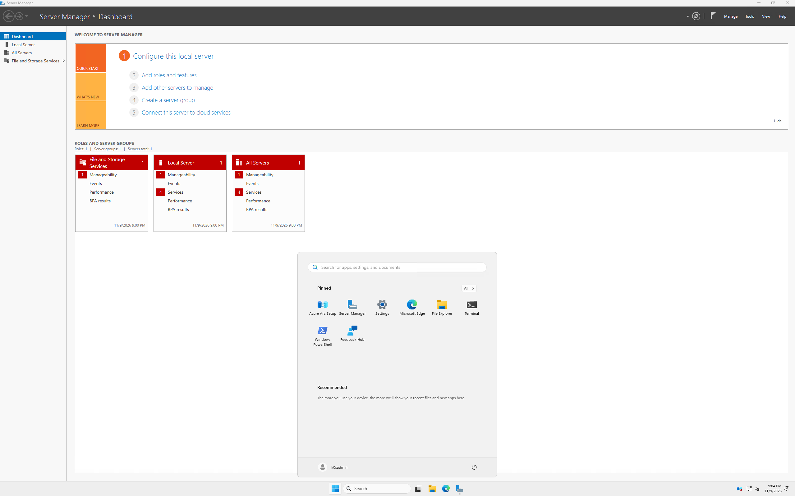
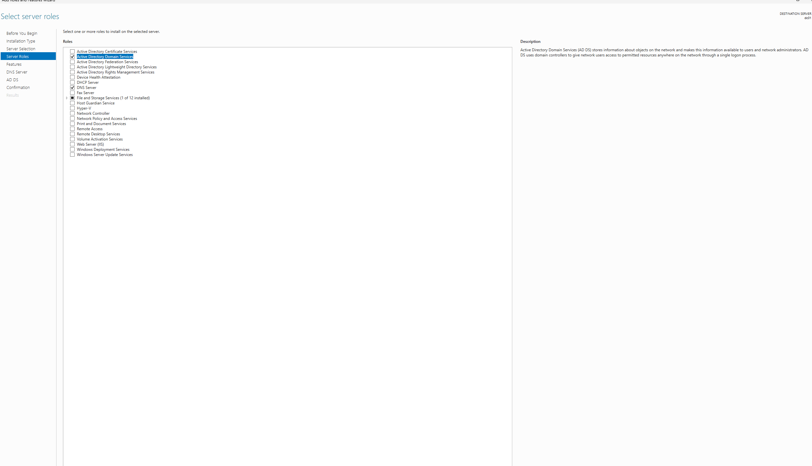
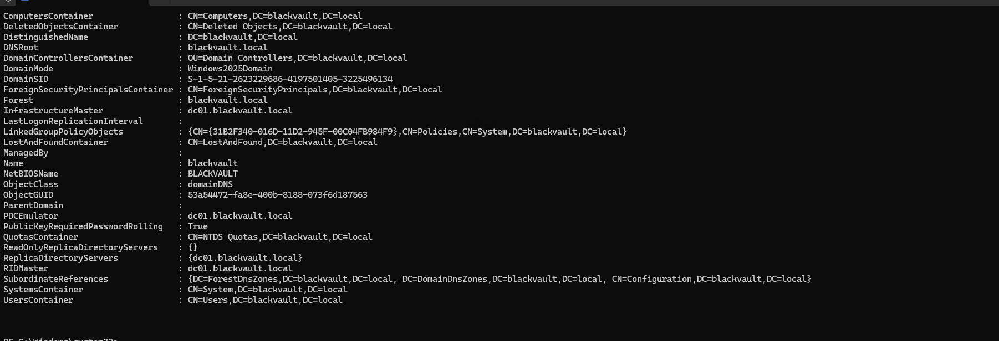
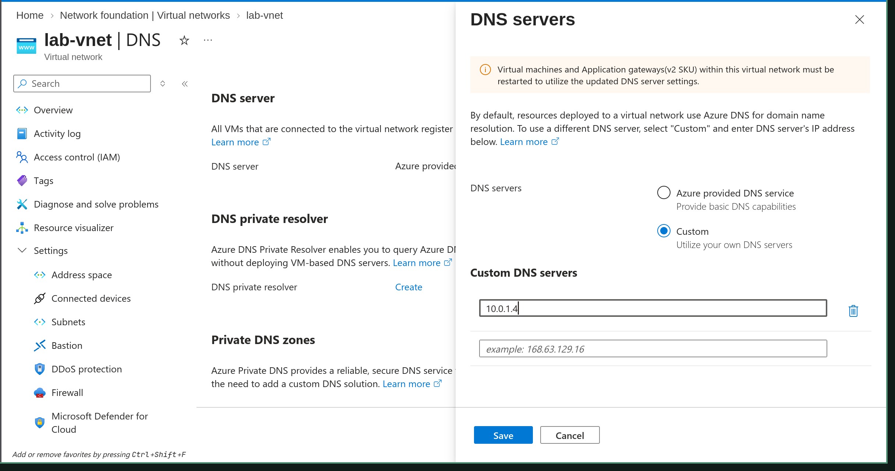
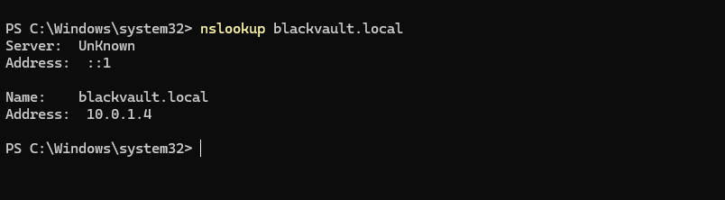

# Week 1 - Daily Log (Azure Detection Lab)

## Day 1

**Goal for today:**
- Stand up the Azure foundation (subscription, budget guardrails, a segmented virtual network) and deploy the first domain controller, `dc01` running `blackvault.local`, with DNS wired to it

**What I did:**

*Foundation*
1. Created an Azure free account ($200 credit, 30-day window).
2. Set budget alerts in **Cost Management → Budgets** so spend can't creep up unnoticed:
   - Budget amount `$200`, monthly reset
   - Alert thresholds at **25% / 50% / 75%** ($50 / $100 / $150) to my email
3. Created the resource group that holds the whole lab (one-click teardown later):
   - Name `lab-rg`, region **East US** (used for everything to avoid cross-region traffic)
4. Created the virtual network (Azure's VPC) with a segmented layout:
   - VNet `lab-vnet`, address space `10.0.0.0/16`
   - Subnet `Domain` → `10.0.1.0/24` (trusted lab machines)
   - Subnet `honeypot` → `10.0.0.0/24` (isolated, for the Cowrie honeypot later)
   - Left both subnets **non-private** (kept default outbound) so lab VMs can reach the internet (updates, EDR cloud) without paying for a NAT gateway
5. Created and attached a network security group (firewall) to each subnet during VNet creation:
   - `lab-nsg` → `Domain` subnet
   - `honeypot-nsg` → `honeypot` subnet
6. Left `lab-nsg` **closed to inbound by default**, so RDP would be scoped to my own IP once a VM existed. Confirmed **Azure Bastion was disabled** (it's ~$140/month and would have eaten most of the credit).

*Domain controller*
7. Started creating `dc01`, a **Windows Server 2025 Datacenter, Gen2, x64** machine destined for the `Domain` subnet. Wanted a 2 vCPU / 8 GiB burstable size but hit a run of VM-availability blockers (see Problems), so ended up on **Standard_D2s_v4** (2 vCPU, 8 GiB), the only general-purpose family with quota in East US.
8. Configured the VM to stay cheap and correct:
   - OS disk: **Standard SSD** (not Premium), **Delete OS disk with VM** enabled
   - Networking: VNet `lab-vnet`, subnet `Domain`, **NIC NSG = None** (the subnet already has `lab-nsg`), new public IP for RDP management, no VM-level inbound ports opened
   - Management: **Auto-shutdown ON** (midnight ET), since the lab is not run 24/7, so compute + Windows license only bill while I'm working
9. After deploy, pinned the DC's private IP to **Static at the Azure level**:
   - `dc01 → Networking → NIC → IP configurations → ipconfig1 → Assignment: Static`, kept `10.0.1.4`
   - Did **not** touch the Windows NIC. Azure VMs keep the OS on DHCP; setting a static IP inside Windows can break connectivity
10. Added the only inbound rule `lab-nsg` needs, scoped to just me:
    - Source: my public IP (`curl ifconfig.me`) as `/32`, Destination port `3389/TCP`, Allow, Priority `300`, name `Allow-RDP-MyIP`
11. RDP'd into the DC from my Mac (Windows App), then installed the roles via **Server Manager → Add Roles and Features**:
    - **Active Directory Domain Services** + **DNS Server**
    - Cleared a *pending restart* that was blocking the install with a reboot, then re-ran it
    - Clicked past the "no static IP address" validation warning (expected on Azure, since the IP is pinned at the platform level)

    

    

12. Promoted the server to a domain controller:
    - **Add a new forest** → root domain `blackvault.local`
    - Set a **DSRM** (Directory Services Restore Mode) recovery password
    - Ignored the DNS delegation warning (no authoritative parent zone exists for a standalone lab domain, so no action required)
    - Server rebooted automatically into the new domain
13. After reboot, logged back in as **`BLACKVAULT\k0sadmin`** (now a domain account) and verified the domain:
    ```powershell
    Get-ADDomain
    ```
    Confirmed `DNSRoot: blackvault.local`, `DomainMode: Windows2025Domain`, `InfrastructureMaster: dc01.blackvault.local`.

    

14. Pointed the VNet's DNS at the DC so future machines can find and join the domain:
    - `lab-vnet → DNS servers → Custom → 10.0.1.4`, then rebooted the DC so it picked up the setting

    

    Verified name resolution from the DC itself. The domain resolves to the DC's static IP:
    ```powershell
    nslookup blackvault.local
    # Name: blackvault.local  ->  Address: 10.0.1.4
    ```

    

15. Stopped (**deallocated**) the VM from the portal to halt compute + Windows license billing for the day, leaving the disk/IP in place so the DC is ready to resume.

**Problems hit:**
- VM size selection was a fight, and three *different* blockers looked almost identical:
  - **Capacity**: `B2ms` showed "currently unavailable in eastus" (regional capacity, transient)
  - **Subscription restriction**: `B2as_v2` returned `NotAvailableForSubscription` (the free account type was blocked from that family)
  - **Zero quota**: after upgrading, deployment failed with `QuotaExceeded ... standardBasv2Family ... Current Limit: 0` (the B-series v2 family had no quota at all in East US)
- A **pending restart** silently blocked the AD DS role install (red X), with only a generic message until I checked the detail.
- Promotion threw two scary-looking warnings: "no static IP address found" and "a delegation for this DNS server cannot be created."
- Windows VMs are far more expensive than expected. The create-blade estimate was ~$254/mo because the **Windows license (~$107/mo) is billed on top of compute**, which killed the original "everything 24/7" plan.

**How I solved them:**
- **Upgraded the subscription from free to pay-as-you-go** (Basic support plan, free) to clear the `NotAvailableForSubscription` restriction. The remaining **$200 credit carries over for the full 30 days**, so this didn't cost anything up front.
- When `Basv2` quota was still 0, switched to **D2s_v4**, since only the D-series v4 family had quota available in East US.
- Rebooted to clear the pending restart, then re-ran the role install cleanly.
- Confirmed both promotion warnings were **benign for an isolated lab**: Azure pins the static IP at the platform level (so the Windows-side warning is cosmetic), and there's no parent DNS zone to delegate from, so I continued past both.
- Dropped the 24/7 goal for the Windows boxes and relied on **auto-shutdown**, so the expensive compute + license only accrue while I'm actively working. The disk/public IP (~$14/mo) is the only continuous cost.
