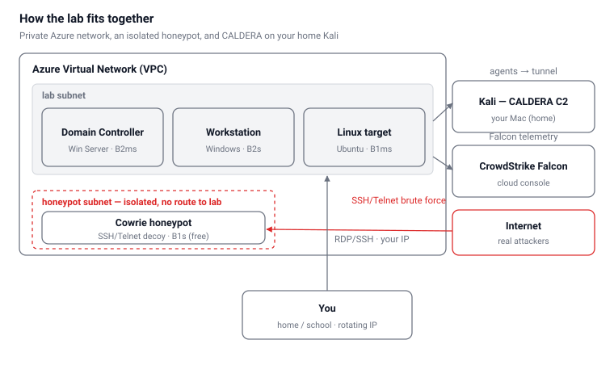

# Azure Detection Lab

A self-contained detection-engineering lab on Azure: a small Active Directory domain monitored by **CrowdStrike Falcon**, adversary emulation driven from **MITRE CALDERA** on a home Kali box, and an **isolated Cowrie honeypot** catching real internet attackers — all built to run inside the **$200 Azure free credit**.

## Overview

This is a private Azure virtual network (Azure's equivalent of a VPC) holding three machines I both attack and defend, plus a separate, isolated honeypot that faces the public internet. Falcon runs on the three lab machines and ships telemetry to CrowdStrike's cloud, giving a detection console. Adversary emulation is driven from CALDERA running on a home Kali box; the Azure machines run CALDERA agents that call back to it through a tunnel. The three lab hosts beacon out to CALDERA and report to Falcon's cloud, while the honeypot sits in its own subnet with **no route back to the lab**.

## Components

| Component | Spec | Role |
| --- | --- | --- |
| Domain Controller | Windows Server · B2ms | AD DS + DNS; hub of the `lab.local` domain |
| Windows workstation | B2s · domain-joined | Falcon + CALDERA agent |
| Linux target | Ubuntu · B1ms | Falcon + CALDERA agent |
| Cowrie honeypot | B1s (free hours) | Isolated, internet-facing, SSH/Telnet decoy |
| CALDERA C2 | home Kali (Mac) | Adversary-emulation server, reached via tunnel |
| CrowdStrike Falcon | cloud console | Receives telemetry from the three lab machines |

## Budget

Runs all four machines 24/7 and fits inside the $200 credit for the full 30 days, at roughly **$153/month**. Figures are approximate pay-as-you-go estimates — confirm in the Azure pricing calculator.

| Machine | Size | Runs | Est. / month |
| --- | --- | --- | --- |
| Domain Controller | B2ms (8 GB) | 24/7 | ~$70 |
| Windows workstation | B2s (4 GB) | 24/7 | ~$35 |
| Linux target | B1ms (2 GB) | 24/7 | ~$15 |
| Cowrie honeypot | B1s (free hours) | 24/7 | ~$0 |
| Disks (4 × lean Standard SSD) | 32–64 GB | — | ~$25 |
| Public IPs (2) | Standard | — | ~$8 |
| CALDERA C2 | home Kali (Mac) | — | $0 |
| **Total** | | | **~$153** |

- **Free tier covers the honeypot** — the free account includes 750 B1s hours/month; one B1s at 24/7 is ~730 hours.
- **Cowrie, not T-Pot** — T-Pot needs ~8 GB RAM and a 128 GB disk (~$85/month) and can't be shut down. Cowrie catches SSH/Telnet brute-forcing on the free B1s.
- **Credit, not a card** — on a free account, if the credit runs out the services are disabled rather than charged.

## Build (one-time)

1. **Account + guardrails** — Azure free account; budget alerts at $50 / $100 / $150.
2. **Network** — one resource group; one VNet with two subnets (`lab`, `honeypot`); an NSG on each. The `honeypot` NSG denies all outbound to the `lab` subnet.
3. **Lab VMs** — deploy the DC (promote to AD DS + DNS, create `lab.local`), the workstation (domain-joined), and the Linux target. Point the VNet's DNS at the DC's private IP.
4. **Falcon** — install the sensor on all three; put them in their own host group + prevention policy; add one narrow exclusion for the CALDERA agent binary.
5. **CALDERA** — install on the home Kali box, UI bound to localhost; a tunnel (`cloudflared`/`ngrok`) gives the agents a stable callback address.
6. **Honeypot** — deploy Cowrie on the B1s in the isolated subnet; lock down outbound; snapshot it clean and treat it as disposable.

## Working session

1. **Open access** — update the `lab` NSG inbound rule to your current public IP (home/school IP rotates).
2. **Start CALDERA + tunnel** — the tunnel gives a public hostname for agent callbacks.
3. **Deploy fresh agents** — generate the deploy one-liner (short beacon), drop it to a consistent path (e.g. `C:\lab\agent.exe`) so the Falcon exclusion keeps matching.
4. **Emulate + observe** — run an adversary profile or individual abilities, timestamp each run, and match the detections in Falcon back to the techniques.
5. **Wind down** — stop the operation, kill the tunnel, optionally re-close the NSG rule.

## 30-day schedule

**Week 1 — Build**

| Day | Focus |
| --- | --- |
| 1 | Account, budget alerts, resource group, VNet + both subnets, both NSGs |
| 2 | Deploy + promote the DC; create `lab.local` |
| 3 | Deploy workstation + Linux target; domain-join; point VNet DNS at the DC |
| 4 | Install Falcon on all three; host group + prevention policy + CALDERA exclusion |
| 5 | CALDERA on Kali; tunnel; test agent; confirm callback and first detections |
| 6 | Deploy Cowrie; lock down outbound; verify no route to lab; snapshot clean |
| 7 | Catch-up + fixes; check Cost Management burn rate |

**Weeks 2–3 — Operate and learn** — work CALDERA from discovery → credential access → lateral movement, one area per session; match each technique to Falcon detections; review honeypot logs against the emulated noise; around day 14, tune Falcon (detect vs. block).

**Week 4 — Wind down** — run full adversary profiles, write up findings, export notes/captures, then tear down or deallocate before the credit ends.

## Guardrails & responsibilities

- **Honeypot isolation is the hard rule.** No route to the `lab` subnet, locked-down outbound. A compromised honeypot must never become a launchpad against anyone else.
- **Only emulate against my own VMs.** Pointing any tool at resources I don't own is out of scope.
- **Falcon exclusion stays narrow** — the specific CALDERA agent binary by path, never a whole folder or a "disable detections" policy.
- **Cap log volume** — if forwarding to Log Analytics/Sentinel, set a daily data cap.
- **Treat the honeypot as disposable** — snapshot clean, rebuild regularly, share no credentials with the rest of the lab.

---

*Personal learning lab. Everything here targets only resources I own.*

**Stack:** Azure · Active Directory · CrowdStrike Falcon · MITRE CALDERA · Cowrie · detection engineering
